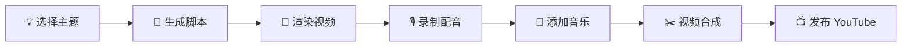

<div align="center">

# 🎬 Andy Manim Video

**Code animations 10x faster than After Effects**

从脚本到爆款 —— 完整的 3Blue1Brown 视频制作工具链

[](LICENSE)
[](https://www.python.org/downloads/)
[](https://www.manim.community/)
[](https://github.com/AIPMAndy/andy-manim-video/stargazers)

[English](README_EN.md) | **简体中文**


*注意力机制可视化讲解 - 100 秒完整示例*

[查看完整示例](./examples/attention_mechanism) • [快速开始](#-30秒快速开始) • [文档](./SKILL.md)

</div>

---

## 🆚 为什么选择 Andy Manim Video？

**问题**: After Effects 改一个参数要 20 分钟，Manim 原生要从零写代码，如何快速迭代？

| 能力 | After Effects | Manim 原生 | **Andy Manim Video** |
|------|:-------------:|:----------:|:-------------------:|
| 💰 免费使用 | ❌ $20/月 | ✅ | ✅ |
| ⚡ 单次迭代 | 🐌 20分钟 | 🔸 需写代码 | ⚡ **2分钟** |
| 🎨 开箱即用模板 | ⚠️ 需购买 | ❌ | ✅ **3种场景** |
| 🔧 CLI 一键生成 | ❌ | ⚠️ 手动命令 | ✅ **一行命令** |
| 📦 零依赖安装 | N/A | ❌ 需 LaTeX (4GB) | ✅ **纯 Python** |
| 🎬 完整工作流 | ⚠️ 仅编辑 | ⚠️ 仅渲染 | ✅ **生成到发布** |
| 🎯 3Blue1Brown 风格 | ⚠️ 手动模仿 | ⚠️ 需配置 | ✅ **预设配色** |
| 📖 完整示例项目 | ⚠️ 需购买课程 | ⚠️ 分散文档 | ✅ **注意力机制** |

**核心差异**: 不只是代码化动画，而是**生产级工具** —— 从想法到成品的完整链路。

---

## 🚀 30秒快速开始

```bash
# 1️⃣ 一行安装
pip install manim && npm install -g andy-manim-video

# 2️⃣ 一行生成
andy-manim-video generate --topic "Neural Networks" --output-dir ./my-video

# 3️⃣ 一键渲染
cd my-video && ./render_all.sh high

# 🎉 视频已就绪！
open media/videos/*/1080p60/*.mp4
```

**5 分钟后，你将拥有**:
- ✅ 4 个高质量场景 (1080p60)
- ✅ 3Blue1Brown 配色方案
- ✅ 可直接发布的 MP4 文件

---

## ✨ 核心特性

<table>
<tr>
<td width="50%">

### 🎨 3Blue1Brown 配色

4 套预设方案，一键切换

```python
# 默认风格
QUERY_COLOR = "#00FFFF"    # 青色
KEY_COLOR = "#FF00FF"      # 洋红
VALUE_COLOR = "#FFFF00"    # 黄色
BG_COLOR = "#171717"       # 深色背景
```

</td>
<td width="50%">

### ⚡ 10倍迭代效率

代码化控制，秒级修改

```python
# 改配色只需 1 秒
QUERY_COLOR = "#FF0000"  # 一行搞定

# vs After Effects: 
# 重新调整 20 分钟 ❌
```

</td>
</tr>
<tr>
<td width="50%">

### 🎯 开箱即用模板

3 种场景，填参数即可

- **Intro** - 疑问式开场钩子 ✨
- **Concept** - 三要素讲解
- **Conclusion** - 要点总结

</td>
<td width="50%">

### 📦 零依赖设计

无需 4GB LaTeX 安装

```python
# ❌ 原生 Manim 需要
pip install manim  # + 4GB LaTeX

# ✅ Andy Manim Video
pip install manim  # 仅此而已
```

</td>
</tr>
</table>

---

## 🎬 完整示例：注意力机制

<div align="center">

| 场景 | 时长 | 文件大小 | 效果 |
|------|:----:|:--------:|------|
| **Intro** | 10s | 332KB | "But what is Attention?" |
| **Basics** | 20s | 509KB | 问题设定 |
| **MathSetup** | 40s | 1.0MB | Q/K/V 讲解 ✨ |
| **Conclusion** | 30s | 1.1MB | 要点回顾 |

**总计**: 100 秒 • 3MB • 1080p60

[查看完整代码](./examples/attention_mechanism) | [下载示例视频](#)

</div>

---

## 📖 使用指南

### 方式 1: CLI 工具（推荐）

```bash
# 完整工作流（交互式）
andy-manim-video full

# 仅生成脚本
andy-manim-video generate \
  --topic "Transformer Architecture" \
  --duration 3 \
  --style cyberpunk

# 仅渲染视频
andy-manim-video render \
  --script ./script.py \
  --quality production  # 4K60
```

### 方式 2: 使用模板

```python
from templates.intro_scene import IntroScene

class MyIntro(IntroScene):
    TOPIC = "Transformer"
    PRIMARY_COLOR = "#00FFFF"
```

```bash
manim -pqh script.py MyIntro
```

### 方式 3: 从示例改

```bash
# 复制注意力机制示例
cp -r examples/attention_mechanism ./my-topic

# 修改主题
sed -i '' 's/Attention Mechanism/Your Topic/g' my-topic/*.py

# 渲染
cd my-topic && ./render_all.sh high
```

---

## 🎨 配色方案

<table>
<tr>
<th>3Blue1Brown</th>
<th>Cyberpunk</th>
<th>Nature</th>
<th>Minimal</th>
</tr>
<tr>
<td>

```python
PRIMARY = "#00FFFF"
SECONDARY = "#FF00FF"
ACCENT = "#FFFF00"
BG = "#171717"
```

</td>
<td>

```python
PRIMARY = "#FF00FF"
SECONDARY = "#00FFFF"
ACCENT = "#FFFF00"
BG = "#0A0E27"
```

</td>
<td>

```python
PRIMARY = "#7CFC00"
SECONDARY = "#FF69B4"
ACCENT = "#FFD700"
BG = "#1B2631"
```

</td>
<td>

```python
PRIMARY = "#000000"
SECONDARY = "#404040"
ACCENT = "#808080"
BG = "#FFFFFF"
```

</td>
</tr>
</table>

---

## 📦 场景模板库

### 🎯 Intro Scene - 开场钩子

```python
"But what is {TOPIC}?"
→ 疑问式标题 + 逐字显现效果 ✨
```

**用户反馈**: *"这个出字的效果还不错"*

**效果**: 制造悬念感，提升观看体验

### 🎓 Concept Scene - 核心讲解

```python
三大要素依次显示 + 可视化演示
→ Query, Key, Value 矩阵运算
```

### 🎉 Conclusion Scene - 总结结尾

```python
要点回顾 + 结束语 + CTA
→ 3 个 Takeaway + 订阅号召
```

[查看所有模板](./templates) | [自定义模板教程](./SKILL.md#scene-templates)

---

## 🛠️ 完整工作流



### Phase 1: 脚本生成 (2分钟)

```bash
andy-manim-video generate --topic "Neural Networks"
```

### Phase 2: 视频渲染 (5分钟)

```bash
./render_all.sh high  # 1080p60
```

### Phase 3: 配音制作 (10分钟)

推荐工具: [ElevenLabs](https://elevenlabs.io/) (AI配音，最自然)

### Phase 4: 音频合成 (2分钟)

```bash
ffmpeg -i video.mp4 -i voiceover.mp3 -c:v copy -c:a aac output.mp4
```

### Phase 5: 视频合成 (15分钟)

推荐工具: [DaVinci Resolve](https://www.blackmagicdesign.com/products/davinciresolve) (免费，专业)

### Phase 6: YouTube 发布 (5分钟)

**标题公式**: `"But what is {TOPIC}? | {SUBTITLE}"`

[查看完整发布指南](./SKILL.md#youtube-publishing)

---

## 📊 性能对比

### ⚡ 迭代效率

| 工具 | 单次迭代 | 10次迭代 | 版本控制 | 协作 |
|------|:--------:|:--------:|:-------:|:----:|
| **Andy Manim Video** | ⚡ **2分钟** | **20分钟** | ✅ Git | ✅ PR |
| After Effects | 🐌 20分钟 | 200分钟 | ❌ 项目文件 | ⚠️ 文件传输 |
| PowerPoint | 🐌 30分钟 | 300分钟 | ❌ 无 | ⚠️ 邮件 |

**效率提升**: 10 倍 🚀

### 🎯 质量对比

| 维度 | Manim | After Effects | PowerPoint |
|------|:-----:|:-------------:|:----------:|
| 数学精度 | 🎯 完美 | 👌 手动对齐 | 😞 粗糙 |
| 动画流畅度 | ✅ 60fps | ✅ 60fps | ⚠️ 30fps |
| 可复现性 | ✅ 100% | ❌ 依赖操作 | ❌ 依赖操作 |
| 代码审查 | ✅ 支持 | ❌ 不适用 | ❌ 不适用 |

---

## 🎓 学习资源

- 📚 [完整技能文档](./SKILL.md) - 从入门到精通
- 🎬 [注意力机制示例](./examples/attention_mechanism) - 100秒完整案例
- 📖 [Manim 官方文档](https://docs.manim.community/) - 深入学习
- 🎥 [3Blue1Brown 频道](https://www.youtube.com/c/3blue1brown) - 灵感来源

---

## 🛠️ 故障排除

<details>
<summary><b>问题 1: <code>latex</code> 命令未找到</b></summary>

**解决**: 使用无 LaTeX 版本模板（已内置）

```python
# ❌ 需要 LaTeX
matrix = Matrix([[1, 2], [3, 4]])

# ✅ 无依赖实现
matrix = VGroup(
    Text("["), 
    VGroup(Text("1"), Text("2")).arrange(DOWN),
    Text("]")
).arrange(RIGHT)
```

</details>

<details>
<summary><b>问题 2: 渲染速度慢</b></summary>

**解决**: 使用低质量预览

```bash
# 快速预览（15秒渲染）
manim -pql script.py SceneName

# 最终渲染再用高质量
manim -pqh script.py SceneName
```

</details>

<details>
<summary><b>问题 3: 颜色显示不正确</b></summary>

**检查**: 确保配置了背景色

```python
config.background_color = "#171717"  # 必须设置
```

</details>

[查看完整故障排除指南](./SKILL.md#troubleshooting)

---

## 🤝 贡献

欢迎贡献！我们期待你的 Pull Request。

**贡献方向**:
- 🎨 新的场景模板
- 🌈 新的配色方案
- 📚 使用案例和教程
- 🐛 Bug 修复和优化
- 🌍 文档翻译

[查看贡献指南](./CONTRIBUTING.md)

---

## 🗺️ Roadmap

### v1.1.0 (计划中)
- [ ] Web UI 可视化编辑器
- [ ] 更多场景模板（图表、流程图）
- [ ] 内置 AI 配音集成
- [ ] 视频自动合成
- [ ] YouTube 元数据生成器

### v1.2.0 (未来)
- [ ] 实时预览服务器
- [ ] 协作编辑支持
- [ ] 插件系统
- [ ] 云渲染服务

[查看完整 Roadmap](./CHANGELOG.md)

---

## 🌟 Showcase

使用 Andy Manim Video 制作的精彩视频：

> 🎬 **正在征集**: 如果你用这个工具制作了视频，欢迎提交 PR 展示！

---

## 📄 许可证

MIT License - 详见 [LICENSE](./LICENSE)

**商业使用**: 完全免费，无需授权

---

## 🙏 致谢

- [3Blue1Brown](https://www.3blue1brown.com/) - 灵感来源和视觉风格
- [Manim Community](https://www.manim.community/) - 强大的动画引擎
- 所有贡献者和 Star 支持者 ⭐

---

<div align="center">

## 💬 联系方式

[](https://github.com/AIPMAndy)
[](https://twitter.com/AIPMAndy)
[](mailto:andy@example.com)

---

**Made with ❤️ by Andy**

🎬 Let's make education visual!

---

### ⭐ 如果这个项目对你有帮助，请给一个 Star！

[⬆ 回到顶部](#-andy-manim-video)

</div>
