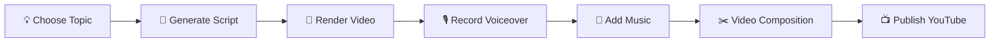

<div align="center">

# 🎬 Andy Manim Video

**Code animations 10x faster than After Effects**

Complete 3Blue1Brown-style video production toolchain

[](LICENSE)
[](https://www.python.org/downloads/)
[](https://www.manim.community/)
[](https://github.com/AIPMAndy/andy-manim-video/stargazers)

**English** | [简体中文](README.md)


*Attention Mechanism Visualization - 100s Complete Example*

[See Full Example](./examples/attention_mechanism) • [Quick Start](#-quick-start-in-30-seconds) • [Documentation](./SKILL.md)

</div>

---

## 🆚 Why Andy Manim Video?

**The Problem**: After Effects takes 20 minutes to iterate, vanilla Manim requires coding from scratch. How to iterate fast?

| Feature | After Effects | Vanilla Manim | **Andy Manim Video** |
|---------|:-------------:|:-------------:|:--------------------:|
| 💰 Free to Use | ❌ $20/month | ✅ | ✅ |
| ⚡ Single Iteration | 🐌 20 min | 🔸 Need coding | ⚡ **2 min** |
| 🎨 Ready-to-use Templates | ⚠️ Need purchase | ❌ | ✅ **3 scenes** |
| 🔧 CLI One-liner | ❌ | ⚠️ Manual commands | ✅ **Single command** |
| 📦 Zero Dependencies | N/A | ❌ Need LaTeX (4GB) | ✅ **Pure Python** |
| 🎬 Complete Workflow | ⚠️ Edit only | ⚠️ Render only | ✅ **Script to publish** |
| 🎯 3Blue1Brown Style | ⚠️ Manual mimic | ⚠️ Need config | ✅ **Preset colors** |
| 📖 Complete Example | ⚠️ Need courses | ⚠️ Scattered docs | ✅ **Attention Mechanism** |

**Key Difference**: Not just programmatic animation, but a **production-grade tool** — complete pipeline from idea to finished video.

---

## 🚀 Quick Start in 30 Seconds

```bash
# 1️⃣ One-line install
pip install manim && npm install -g andy-manim-video

# 2️⃣ One-line generate
andy-manim-video generate --topic "Neural Networks" --output-dir ./my-video

# 3️⃣ One-click render
cd my-video && ./render_all.sh high

# 🎉 Video ready!
open media/videos/*/1080p60/*.mp4
```

**After 5 minutes, you'll have**:
- ✅ 4 high-quality scenes (1080p60)
- ✅ 3Blue1Brown color scheme
- ✅ Ready-to-publish MP4 files

---

## ✨ Core Features

<table>
<tr>
<td width="50%">

### 🎨 3Blue1Brown Colors

4 preset schemes, one-click switch

```python
# Default style
QUERY_COLOR = "#00FFFF"    # Cyan
KEY_COLOR = "#FF00FF"      # Magenta
VALUE_COLOR = "#FFFF00"    # Yellow
BG_COLOR = "#171717"       # Dark bg
```

</td>
<td width="50%">

### ⚡ 10x Iteration Speed

Code-based control, instant changes

```python
# Change color in 1 second
QUERY_COLOR = "#FF0000"  # Done!

# vs After Effects: 
# Re-adjust 20 minutes ❌
```

</td>
</tr>
<tr>
<td width="50%">

### 🎯 Ready-to-use Templates

3 scenes, just fill parameters

- **Intro** - Question-style hook ✨
- **Concept** - Three-element breakdown
- **Conclusion** - Key takeaways

</td>
<td width="50%">

### 📦 Zero Dependency Design

No 4GB LaTeX installation needed

```python
# ❌ Vanilla Manim needs
pip install manim  # + 4GB LaTeX

# ✅ Andy Manim Video
pip install manim  # That's it!
```

</td>
</tr>
</table>

---

## 🎬 Complete Example: Attention Mechanism

<div align="center">

| Scene | Duration | File Size | Effect |
|-------|:--------:|:---------:|--------|
| **Intro** | 10s | 332KB | "But what is Attention?" |
| **Basics** | 20s | 509KB | Problem setup |
| **MathSetup** | 40s | 1.0MB | Q/K/V explanation ✨ |
| **Conclusion** | 30s | 1.1MB | Key takeaways |

**Total**: 100s • 3MB • 1080p60

[View Full Code](./examples/attention_mechanism) | [Download Sample Videos](#)

</div>

---

## 📖 Usage Guide

### Method 1: CLI Tool (Recommended)

```bash
# Complete workflow (interactive)
andy-manim-video full

# Generate script only
andy-manim-video generate \
  --topic "Transformer Architecture" \
  --duration 3 \
  --style cyberpunk

# Render video only
andy-manim-video render \
  --script ./script.py \
  --quality production  # 4K60
```

### Method 2: Use Templates

```python
from templates.intro_scene import IntroScene

class MyIntro(IntroScene):
    TOPIC = "Transformer"
    PRIMARY_COLOR = "#00FFFF"
```

```bash
manim -pqh script.py MyIntro
```

### Method 3: Modify from Example

```bash
# Copy attention mechanism example
cp -r examples/attention_mechanism ./my-topic

# Change topic
sed -i '' 's/Attention Mechanism/Your Topic/g' my-topic/*.py

# Render
cd my-topic && ./render_all.sh high
```

---

## 🎨 Color Schemes

<table>
<tr>
<th>3Blue1Brown</th>
<th>Cyberpunk</th>
<th>Nature</th>
<th>Minimal</th>
</tr>
<tr>
<td>

```python
PRIMARY = "#00FFFF"
SECONDARY = "#FF00FF"
ACCENT = "#FFFF00"
BG = "#171717"
```

</td>
<td>

```python
PRIMARY = "#FF00FF"
SECONDARY = "#00FFFF"
ACCENT = "#FFFF00"
BG = "#0A0E27"
```

</td>
<td>

```python
PRIMARY = "#7CFC00"
SECONDARY = "#FF69B4"
ACCENT = "#FFD700"
BG = "#1B2631"
```

</td>
<td>

```python
PRIMARY = "#000000"
SECONDARY = "#404040"
ACCENT = "#808080"
BG = "#FFFFFF"
```

</td>
</tr>
</table>

---

## 📦 Scene Template Library

### 🎯 Intro Scene - Opening Hook

```python
"But what is {TOPIC}?"
→ Question-style title + Letter-by-letter reveal ✨
```

**User Feedback**: *"The text animation effect is quite good"*

**Effect**: Creates suspense, enhances viewing experience

### 🎓 Concept Scene - Core Explanation

```python
Three elements sequentially + Visual demo
→ Query, Key, Value matrix operations
```

### 🎉 Conclusion Scene - Summary & Wrap-up

```python
Key takeaways + Closing + CTA
→ 3 Takeaways + Subscribe call
```

[View All Templates](./templates) | [Custom Template Tutorial](./SKILL.md#scene-templates)

---

## 🛠️ Complete Workflow



### Phase 1: Script Generation (2 min)

```bash
andy-manim-video generate --topic "Neural Networks"
```

### Phase 2: Video Rendering (5 min)

```bash
./render_all.sh high  # 1080p60
```

### Phase 3: Voiceover Recording (10 min)

Recommended: [ElevenLabs](https://elevenlabs.io/) (AI voice, most natural)

### Phase 4: Audio Composition (2 min)

```bash
ffmpeg -i video.mp4 -i voiceover.mp3 -c:v copy -c:a aac output.mp4
```

### Phase 5: Video Composition (15 min)

Recommended: [DaVinci Resolve](https://www.blackmagicdesign.com/products/davinciresolve) (Free, Professional)

### Phase 6: YouTube Publishing (5 min)

**Title Formula**: `"But what is {TOPIC}? | {SUBTITLE}"`

[View Complete Publishing Guide](./SKILL.md#youtube-publishing)

---

## 📊 Performance Comparison

### ⚡ Iteration Efficiency

| Tool | Single Iteration | 10 Iterations | Version Control | Collaboration |
|------|:----------------:|:-------------:|:---------------:|:-------------:|
| **Andy Manim Video** | ⚡ **2 min** | **20 min** | ✅ Git | ✅ PR |
| After Effects | 🐌 20 min | 200 min | ❌ Project files | ⚠️ File transfer |
| PowerPoint | 🐌 30 min | 300 min | ❌ None | ⚠️ Email |

**Efficiency Boost**: 10x 🚀

### 🎯 Quality Comparison

| Dimension | Manim | After Effects | PowerPoint |
|-----------|:-----:|:-------------:|:----------:|
| Math Precision | 🎯 Perfect | 👌 Manual align | 😞 Rough |
| Animation Smoothness | ✅ 60fps | ✅ 60fps | ⚠️ 30fps |
| Reproducibility | ✅ 100% | ❌ Operation-dependent | ❌ Operation-dependent |
| Code Review | ✅ Supported | ❌ Not applicable | ❌ Not applicable |

---

## 🎓 Learning Resources

- 📚 [Complete Skill Documentation](./SKILL.md) - From beginner to advanced
- 🎬 [Attention Mechanism Example](./examples/attention_mechanism) - 100s complete case
- 📖 [Manim Official Docs](https://docs.manim.community/) - Deep learning
- 🎥 [3Blue1Brown Channel](https://www.youtube.com/c/3blue1brown) - Inspiration source

---

## 🛠️ Troubleshooting

<details>
<summary><b>Issue 1: <code>latex</code> command not found</b></summary>

**Solution**: Use LaTeX-free templates (built-in)

```python
# ❌ Requires LaTeX
matrix = Matrix([[1, 2], [3, 4]])

# ✅ Zero-dependency implementation
matrix = VGroup(
    Text("["), 
    VGroup(Text("1"), Text("2")).arrange(DOWN),
    Text("]")
).arrange(RIGHT)
```

</details>

<details>
<summary><b>Issue 2: Slow rendering</b></summary>

**Solution**: Use low quality for preview

```bash
# Quick preview (15s render)
manim -pql script.py SceneName

# Use high quality for final
manim -pqh script.py SceneName
```

</details>

<details>
<summary><b>Issue 3: Incorrect colors</b></summary>

**Check**: Ensure background color is configured

```python
config.background_color = "#171717"  # Must set
```

</details>

[View Complete Troubleshooting Guide](./SKILL.md#troubleshooting)

---

## 🤝 Contributing

Contributions welcome! We look forward to your Pull Requests.

**Contribution Areas**:
- 🎨 New scene templates
- 🌈 New color schemes
- 📚 Use cases and tutorials
- 🐛 Bug fixes and optimizations
- 🌍 Documentation translation

[View Contributing Guide](./CONTRIBUTING.md)

---

## 🗺️ Roadmap

### v1.1.0 (Planned)
- [ ] Web UI visual editor
- [ ] More scene templates (charts, diagrams)
- [ ] Built-in AI voiceover integration
- [ ] Automatic video composition
- [ ] YouTube metadata generator

### v1.2.0 (Future)
- [ ] Real-time preview server
- [ ] Collaborative editing support
- [ ] Plugin system
- [ ] Cloud rendering service

[View Complete Roadmap](./CHANGELOG.md)

---

## 🌟 Showcase

Videos created with Andy Manim Video:

> 🎬 **Call for Submissions**: If you've created videos with this tool, submit a PR to showcase!

---

## 📄 License

MIT License - See [LICENSE](./LICENSE)

**Commercial Use**: Completely free, no authorization needed

---

## 🙏 Acknowledgments

- [3Blue1Brown](https://www.3blue1brown.com/) - Inspiration and visual style
- [Manim Community](https://www.manim.community/) - Powerful animation engine
- All contributors and Star supporters ⭐

---

<div align="center">

## 💬 Contact

[](https://github.com/AIPMAndy)
[](https://twitter.com/AIPMAndy)
[](mailto:andy@example.com)

---

**Made with ❤️ by Andy**

🎬 Let's make education visual!

---

### ⭐ If this project helps you, please give it a Star!

[⬆ Back to Top](#-andy-manim-video)

</div>
