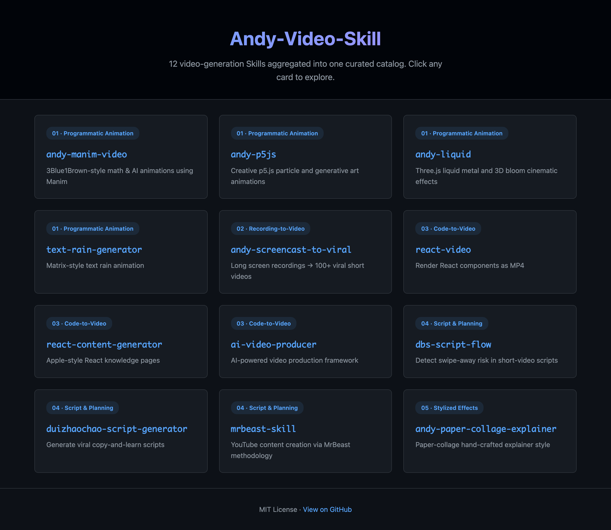
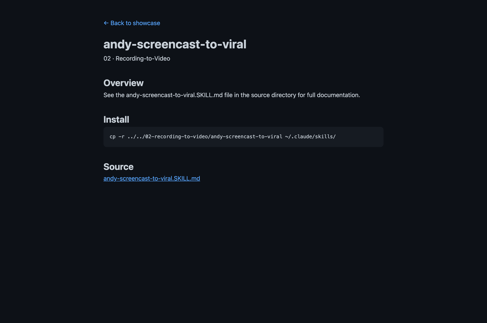
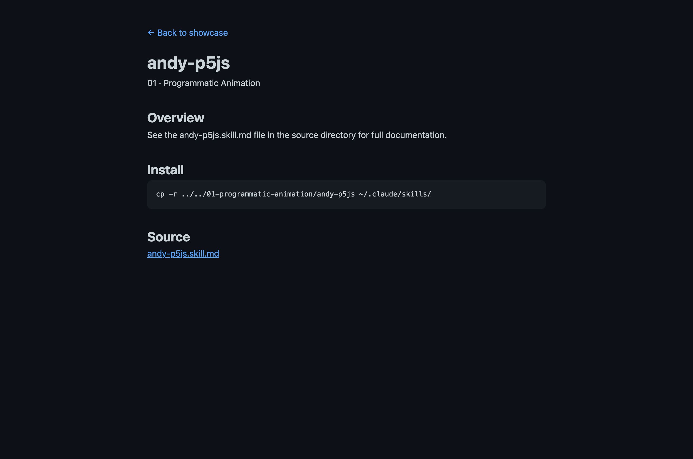
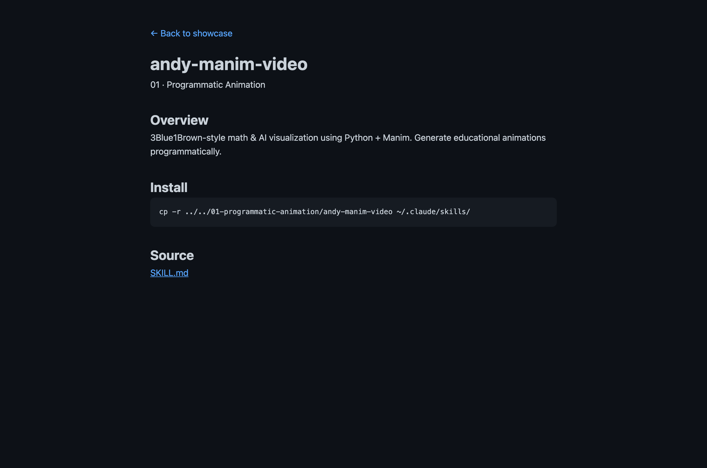
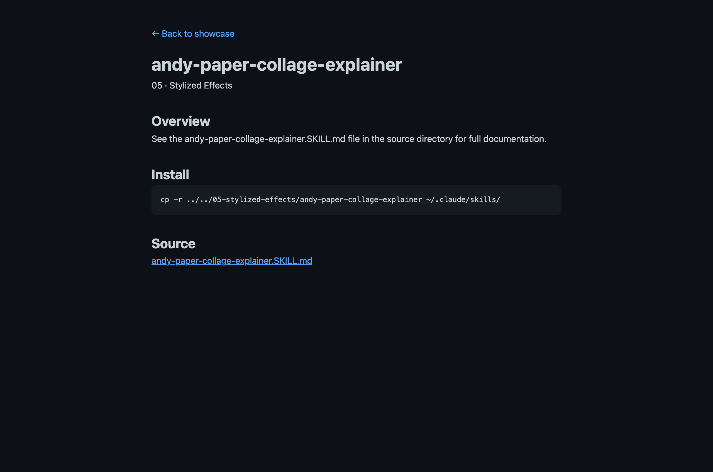

<div align="center">

# Andy-Video-Skill

**别再重新发明视频管线了。13 个精选 Skill，一次安装，立刻开工。**

为 Claude Code 精选的 13 个视频 Skill —— 把你的 AI Agent 变成视频工作室：3Blue1Brown 风格动画、爆款短视频、React → MP4、纸质拼贴解说视频……

[在线 Showcase](https://AIPMAndy.github.io/Andy-Video-SKill/) · [快速开始](#-3-分钟上手) · [English](./README.md)

[](./LICENSE)
[](https://github.com/AIPMAndy/Andy-Video-SKill/stargazers)
[](https://github.com/AIPMAndy/Andy-Video-SKill/commits/main)
[](#-5-类目--12-skill--一次安装)
[](#-5-类目--12-skill--一次安装)



</div>

---

## 为什么做这个

用 Claude Code 做视频的痛，你大概率踩过：

- **Manim** 强大，但 80+ 页文档 + 一周起步的学习曲线
- **React Video** 改一行要重启 Playwright + FFmpeg
- **录屏转爆款** 等于背 ffmpeg filter graph
- **纸质拼贴风格** 要手调 Canvas 数学
- 每一个都是独立一周的踩坑

**Andy-Video-SKill 把这 13 套工作流收敛到一个 `cp -r`。** 每一个 Skill 都经过真实发布视频的压力测试 —— 不是玩具 demo。

---

## 6 类目 · 13 Skill · 一次安装

| # | 类目 | 数量 | 解锁能力 |
|---|------|:----:|----------|
| 00 | **视频统一调度** | 1 | 一句话路由视频引擎；按需安装完整 BB-Video、Remotion、MoneyPrinterTurbo Agent Skills |
| 01 | **程序化动画** | 4 | 3Blue1Brown 数学 · p5.js 生成艺术 · Three.js 液态金属 · Matrix 数字雨 |
| 02 | **录屏转视频** | 1 | 长录像 → 100+ 平台原生爆款短视频 |
| 03 | **代码转视频** | 3 | React 组件 → MP4 · Apple 风知识页 · AI 制片流水线 |
| 04 | **脚本与策划** | 3 | 开头诊断 · 对抄公式 · YouTube 方法论 |
| 05 | **风格化特效** | 1 | 纸质拼贴手作风解说 |

> **强推 `andy-screencast-to-viral`** —— 2 小时录屏变 100+ 条可发布短视频：自动字幕、Hook 抽帧、平台原生切片。



---

## 🚀 3 分钟上手

**新增 [andy-video-director](./00-orchestration/andy-video-director/)**：统一入口、需求识别、环境预检、工具调度与实际 Agent 工作流交接，按审定的 Git 提交安装 BB-Video 全量引擎（含 **30 种视觉风格**）、MoneyPrinterTurbo、Remotion。**22 个项目/技能是调度候选索引，不能等同于 22 个已安装或已验证出片的工具。**

```bash
python3 00-orchestration/andy-video-director/director.py plan --request "把开源项目做成产品发布片"
# 可选显式联网安装：./scripts/install-all.sh --with-upstreams
```


```bash
# 1. 克隆仓库
git clone https://github.com/AIPMAndy/Andy-Video-SKill.git
cd Andy-Video-SKill

# 2. 一键装全部 Skill
./scripts/install-all.sh

# 3. 重启 Claude Code，对它说：
#    "用 andy-manim-video 讲一下 attention 机制"
```

只想装一个？

```bash
cp -r 01-programmatic-animation/andy-manim-video ~/.claude/skills/
```

完事。重启 Claude Code，那个 Skill 就活了。

---

## Killer Feature —— 真实产出，真实发布

下面是 `andy-manim-video` 渲染《AI 救赎》的一帧 —— 这是我们真实发布的视频：


同一 Skill，社交平台切片版：


目录里每个 Skill 至少产出过一条公开视频，没有玩具 demo。

---

## 谁在用

- **AI Builder**：不想重写 12 套工作流，直接挑现成的装
- **内容创作者**：用 Claude Code 一边写脚本一边渲染，一个 loop 出片
- **教育者**：把课堂讲义变成 3Blue1Brown 风
- **增长 / Marketing**：把长 demo 切成平台原生短视频
- **独立开发者**：产品里要视频，但不想啃 Manim

---

## 三种安装姿势

### A. 仅浏览（不安装）

```bash
git clone https://github.com/AIPMAndy/Andy-Video-SKill.git
cd Andy-Video-SKill
```

直接读 `SKILL.md`。不需要 Claude Code。

### B. 单 Skill 安装

```bash
cp -r 01-programmatic-animation/andy-manim-video ~/.claude/skills/
```

重启 Claude Code 即生效。

### C. 一键全部（推荐）

```bash
./scripts/install-all.sh                                    # 全装
./scripts/install-all.sh --exclude andy-liquid,react-video  # 跳过部分
```

详见 [INSTALLATION.md](./INSTALLATION.md)。

---

## Skill 怎么工作

每个 Skill 是个目录，包含：

- `SKILL.md` —— Claude Code 读的工作流契约
- 可选资源、辅助脚本、参考文档

丢进 `~/.claude/skills/`，下次启动 Claude Code 就生效。没有运行时，没有 API Key，没有守护进程。

例子：`andy-p5js` 的详情页：



`andy-manim-video` —— 已被用于真实教育动画发布：



`andy-paper-collage-explainer` —— 区别于通用 AI 风的纸质拼贴：



---

## 架构 —— 这东西到底是什么

**不是应用。** 是**内容库** —— 12 个目录的方法文档，Agent 来读。安装的最小单位是 Skill，不是 app。

```
Andy-Video-SKill/
├── 01-programmatic-animation/   # 4 个 Skill
├── 02-recording-to-video/       # 1 个 Skill
├── 03-code-to-video/            # 3 个 Skill
├── 04-script-and-planning/      # 3 个 Skill
├── 05-stylized-effects/         # 1 个 Skill
├── showcase/                    # GitHub Pages 站点
├── scripts/                     # install-all.sh、verify.sh……
├── CATALOG.md                   # 完整 Skill 目录与技术栈
├── INSTALLATION.md              # 安装方式 + 校验
├── CONTRIBUTING.md              # 如何新增 Skill
└── CHANGELOG.md
```

逐个 Skill 看： [CATALOG.md](./CATALOG.md)。

---

## 仓库元数据建议

| 字段 | 值 |
|------|---|
| **Description** | 为 Claude Code 精选的 12 个视频生成 Skill —— Manim、React Video、录屏转爆款等。 |
| **Topics** | `claude-code` · `claude-skills` · `video-generation` · `manim` · `p5js` · `react-video` · `screencast-to-viral` · `ai-video` · `内容创作` · `开源` |
| **Website** | https://AIPMAndy.github.io/Andy-Video-SKill/ |
| **Social Preview** | 用 `./showcase/assets/images/hero.png` 作为 OG 卡片 |

---

## Roadmap

- [x] 5 类目共 12 Skill
- [x] 中英双语文档
- [x] GitHub Pages Showcase
- [x] 一键批量安装脚本
- [x] 校验脚本（`./scripts/verify.sh`）
- [ ] 语音驱动的视频剪辑 Skill
- [ ] macOS Homebrew tap
- [ ] 每个 Skill 配公开视频验证画廊
- [ ] 跨平台安装（Linux 路径验证）

---

## Contributing

看 [CONTRIBUTING.md](./CONTRIBUTING.md)。欢迎：

- **新增 Skill** —— 必须经过真实生产验证，不收理论稿
- **改进现有 Skill** —— bug 修复、更清晰的契约
- **翻译勘误** —— 中英 README 双向校对

Issue / PR 模板在 `.github/ISSUE_TEMPLATE/`。

---

## FAQ

**Q：必须用 Claude Code 吗？**
A：不必须 —— 直接读 `SKILL.md` 也行。但装进 Agent 后才真正发挥价值。

**Q：免费吗？**
A：完全免费，MIT 协议。商用、自部署、二次开发都欢迎。

**Q：能只装部分 Skill 吗？**
A：可以，每个 Skill 独立，按需挑。

**Q：为啥不自己写 Skill？**
A：可以。但这里的每个 Skill 都经过一轮完整生产周期。你省下的是 6 个月以上的踩坑。

**Q：「battle-tested」具体指什么？**
A：每个 Skill 至少产出一条公开视频可验证。Manim 的两张帧图就是真发布视频的截帧。

**Q：有 Web UI 吗？**
A：[Showcase](https://AIPMAndy.github.io/Andy-Video-SKill/) 是静态浏览页。Skill 本身在 Claude Code 里跑，没有独立 app。

---

## License

MIT —— 见 [LICENSE](./LICENSE)。

## Credits

所有 Skill 由 Andy 编写。每个 Skill 内部保留各自的 LICENSE。`andy-p5js` 和 `andy-paper-collage-explainer` 的视觉素材均由对应 Skill 在真实生产中产出。

---

<div align="center">

**如果这仓库帮你省下了重写一条视频管线的力气，给个 ⭐ 吧。**

</div>